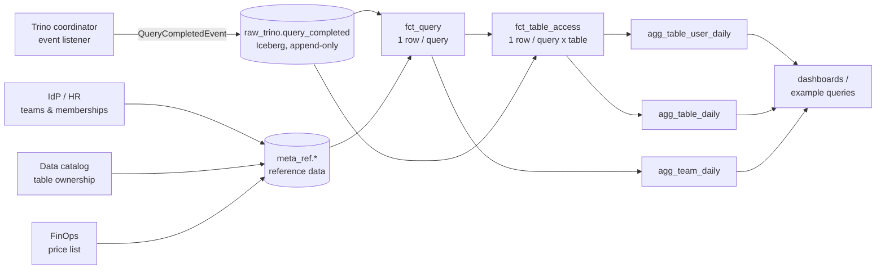

# Meta DWH: usage statistics for Iceberg tables queried through Trino

This repo designs and implements a small **Meta DWH**, a warehouse *about* the
data platform. It turns raw Trino query events (stored in S3 as Iceberg) into a
star schema that answers questions like these, and keeps the history so you can
see how the answers change over time:

* *How many distinct users queried table X between two dates?*
* *How much CPU, memory, scanned data and money did team Y use in that period?*
* Which tables is a team's compute going to? Who uses whose data? Which tables
  nobody reads any more? How does usage trend week over week?



## Contents

| Path | What it is |
|---|---|
| [`docs/data_model.md`](docs/data_model.md) | Tables, grain, keys, relationships (ER diagram) |
| [`docs/design_decisions.md`](docs/design_decisions.md) | Design choices, resource metrics, how data is updated |
| [`docs/assumptions.md`](docs/assumptions.md) | Assumptions, and the extra metadata needed with its structure |
| [`docs/example_queries.md`](docs/example_queries.md) | The two questions (and more) answered, with sample output |
| `sql/ddl/` | DDL: raw source contract, reference tables, Meta DWH tables, calendar |
| `sql/transform/` | Transformations, run in this order: dims, then facts, then aggregates, then dim upserts |
| `sql/views/` | Cost views (usage × versioned price list) |
| `sql/examples/` | Example queries (Q1 = `01_…`, Q2 = `02_…`, `03_…`) |
| `sql/checks/` | Data quality and reconciliation checks |
| `sql/maintenance/` | Iceberg compaction and snapshot expiry |
| `metadwh/` | Python: pipeline runner (incremental and backfill), reference sync, sample-data generator, CLI |
| `orchestration/airflow_dag.py` | Reference Airflow deployment (hourly run, daily maintenance) |
| `reference_data/` | Example reference metadata (teams, memberships, ownership, catalogs, prices) |
| `tests/` | End-to-end and rule-level tests (28 tests) |

## The model in one paragraph

`fct_query` has **one row per query**. It holds every resource metric Trino
reports (CPU, cumulative memory, scanned bytes, written bytes, spill, queueing)
and the team the user belonged to **on the day of the query**.
`fct_table_access` has **one row per query × table × access type (READ or
WRITE)**. It holds the bytes Trino reports for each table, plus an
`allocation_weight` that splits the query's CPU and memory across the tables it
touched. Three daily aggregates make up the historical layer. The key one is
`agg_table_user_daily` (day × table × user): a `COUNT(DISTINCT user)` over it is
exact for *any* period, because distinct counts can't be added up across days.
The dimensions are `dim_team`, `dim_user`, `dim_user_team_history` (SCD2),
`dim_table` and `dim_date`.

## Quick start (local, no infrastructure needed)

All SQL is written in Trino's dialect for production. For local runs and the
tests, the same files run on DuckDB: they are translated automatically with
[sqlglot](https://github.com/tobymao/sqlglot), so there is only one copy of the
transformation logic.

```bash
pip install -r requirements.txt
python -m metadwh demo        # loads 61 days of synthetic Trino events, runs the pipeline,
                              # prints the example queries and the data-quality checks
python -m pytest              # 28 tests: attribution rules, idempotency, late events, ...

# ask your own questions against the demo database
python -m metadwh query sql/examples/01_distinct_users_of_table.sql \
    -p table_fqn=lake.events.page_views -p start_date=2026-09-01 -p end_date=2026-09-30
```

## Running against Trino

```bash
export TRINO_HOST=trino.internal TRINO_PORT=443 TRINO_HTTP_SCHEME=https \
       TRINO_USER=svc_meta_dwh TRINO_PASSWORD=... TRINO_CATALOG=iceberg
python -m metadwh --engine trino init               # schemas, tables, calendar, views
python -m metadwh --engine trino sync-reference     # meta_ref.* from the reference source
python -m metadwh --engine trino run                # incremental, watermark-driven (hourly)
python -m metadwh --engine trino backfill --start 2026-09-01 --end 2026-09-30
python -m metadwh --engine trino check --start 2026-09-28 --end 2026-09-30
```

> **Verification note.** The pipeline was tested end to end on DuckDB (via
> sqlglot) with synthetic events. A live Trino/Iceberg cluster wasn't available
> while building this, so the Trino path (`TrinoEngine`, Iceberg table
> properties, `ALTER TABLE … EXECUTE` maintenance) still needs a first run on a
> real cluster. The SQL deliberately sticks to standard Trino features: `MERGE`,
> `UNNEST`, `FILTER`, and partition-scoped `DELETE`.
