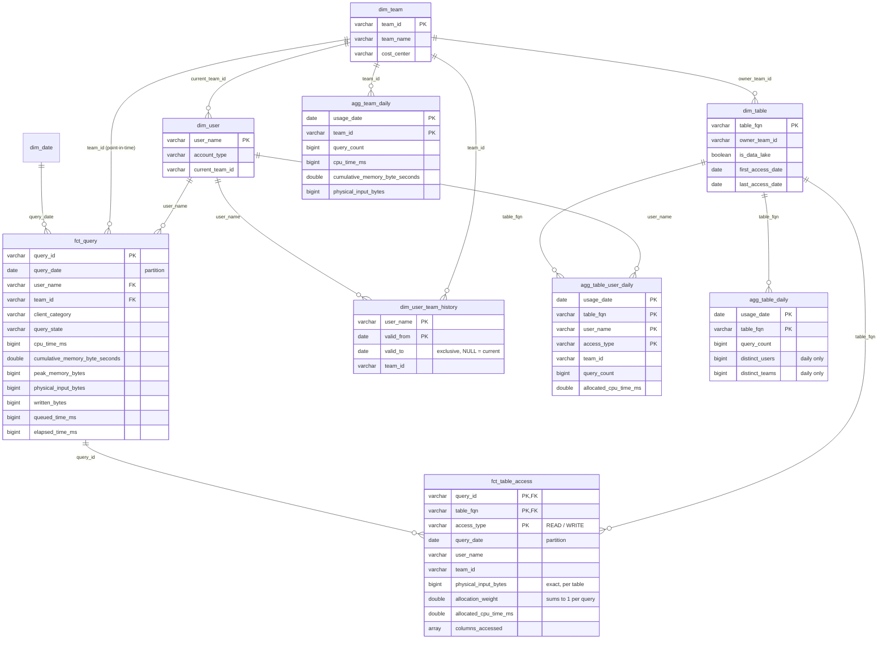

# Data model

Three layers live in three schemas of the Iceberg catalog:

| Schema | Layer | Written by | Contents |
|---|---|---|---|
| `raw_trino` | raw | Trino event listener sink | `query_completed`: one row per delivered `QueryCompletedEvent` (append-only, may contain duplicates) |
| `meta_ref` | reference | reference sync job | metadata Trino does not know: teams, user→team history, accounts, table ownership, catalogs, price list |
| `meta_dwh` | warehouse | this pipeline | dimensions, facts, daily aggregates, cost views, run log |

## Entity-relationship diagram

## Tables, grain and purpose

### Facts

| Table | Grain | Partitioning | Purpose |
|---|---|---|---|
| `fct_query` | one row per `query_id` | `query_date` (UTC completion day) | System of record for **resource usage**. Every metric is additive across queries. Includes queries that touch no table (`SHOW`, `EXPLAIN`, failed parsing), because they still use the cluster. |
| `fct_table_access` | one row per `query_id × table_fqn × access_type` | `query_date` | System of record for **table usage**. One query touching 3 tables gives 3 rows. Holds the exact per-table bytes Trino reports, plus `allocated_*` CPU and memory (see [design decisions](design_decisions.md#multi-table-queries)). |

### Aggregates (the historical layer)

| Table | Grain | Built from | Main use |
|---|---|---|---|
| `agg_table_user_daily` | day × table × user × access type | `fct_table_access` | **Q1 for any period**: `COUNT(DISTINCT user_name)` over a date range is exact. Also user/team breakdowns of table usage. |
| `agg_table_daily` | day × table | `fct_table_access` | Table dashboards and trends: queries, read vs write, daily distinct users and teams, bytes, allocated CPU. |
| `agg_team_daily` | day × team | `fct_query` (+ `fct_table_access` for distinct tables) | **Q2**: resource consumption per team over time, including failed-query CPU and queueing. |

Why three aggregates instead of one: each has a different **natural grain for
its question**. They stay small. With 2,000 users × 30 tables a day, the
largest one gets roughly 60k rows a day; usually far fewer. That makes
dashboards cheap and independent of the size of the fact tables.

### Dimensions

| Table | Grain | Type | Notes |
|---|---|---|---|
| `dim_date` | day | static | ISO week/month starts for trend grouping |
| `dim_team` | team | SCD1 | Includes the unknown member `__unassigned__` |
| `dim_user_team_history` | user × validity interval | SCD2 | Cleaned copy of the IdP history. Intervals never overlap. Used at load time for point-in-time attribution. |
| `dim_user` | Trino user name | SCD1 | account type (human/service), **current** team, first and last query |
| `dim_table` | `catalog.schema.table` | SCD1 | owner team, domain, connector, `is_data_lake`, first and last access date. Also holds tables from ownership metadata that have **never** been queried. |

### Reference tables (`meta_ref`)

These are described in [assumptions.md](assumptions.md#additional-metadata):
`team`, `user_team_membership`, `user_account`, `table_ownership`, `catalog`,
`cost_rate`.

### Operations

`etl_run_log` has one row per pipeline run. The latest successful
`high_watermark` (max raw `ingested_at` processed) drives the next incremental
run.

## Keys

Natural keys are used throughout: `query_id` (globally unique in Trino),
`user_name`, `team_id`, and `table_fqn` (lower-case `catalog.schema.table`).
In an Iceberg lakehouse there is no enforced referential integrity, and
surrogate keys would add a lookup step to every load without any benefit. The
natural keys are stable and readable. Integrity is enforced by the checks in
`sql/checks/data_quality.sql` instead: every fact team exists in `dim_team`,
every accessed table exists in `dim_table`, weights sum to 1, and facts
reconcile with aggregates.

## Additivity cheat-sheet

| Measure | Sum over days | Sum over teams | Sum over tables |
|---|---|---|---|
| `fct_query` resources (cpu, memory, bytes, ...) | ✅ | ✅ | n/a |
| `fct_table_access.allocated_*` | ✅ | ✅ | ✅ (reconciles with `fct_query`) |
| `fct_table_access.physical_input_bytes` | ✅ | ✅ | ✅ (Trino's own per-table number) |
| query counts per table | ✅ | ✅ | ❌ (a query touching 3 tables counts 3 times) |
| `distinct_users`, `distinct_teams` (daily aggregates) | ❌ use `agg_table_user_daily` / `fct_query` | ❌ | ❌ |
